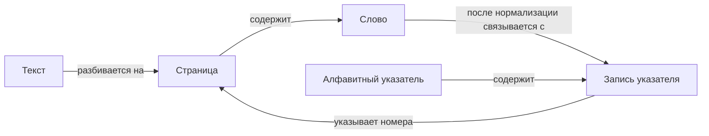
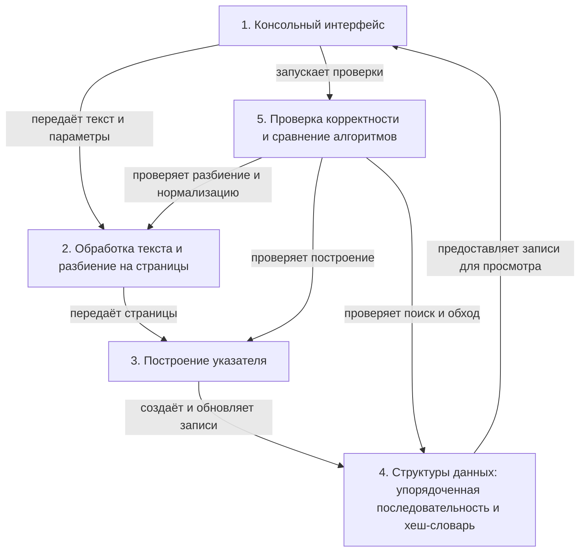

# Дизайн: Алфавитный указатель текста

---

## 1. Постановка задачи

### 1.1. Что делается в работе (идея и концепция)

**Алфавитный указатель** — перечень уникальных слов текста, для каждого из которых указаны номера страниц, на которых оно встречается. Такой указатель позволяет установить расположение интересующего слова в документе без последовательного просмотра всех страниц.

В работе рассматривается исходный текст, который требуется разделить на пронумерованные страницы заданной вместимости, а затем сформировать по этим страницам указатель слов. Размер страницы задаётся пользователем в одной из двух единиц: **количество слов** или **количество символов**. Слова при разбиении сохраняют свою целостность.

Для страниц действуют специальные ограничения вместимости:

* первая страница вмещает не более половины стандартного размера;
* каждая десятая страница вмещает не более трёх четвертей стандартного размера;
* остальные страницы ограничены стандартным размером.

Перед включением слова в указатель оно приводится к единой форме: удаляются знаки препинания по краям, а прописные русские и английские буквы переводятся в строчные. При этом подсчёт вместимости страниц выполняется по исходному тексту, чтобы знаки препинания продолжали учитываться при посимвольном разбиении.

**Цель программы** — получить по заданному тексту отображение вида «слово → номера страниц» и организовать его двумя способами:

1. **Упорядоченный указатель**, в котором записи расположены по алфавиту и доступны для поиска в отсортированной последовательности.
2. **Хеш-указатель**, в котором записи распределяются по корзинам на основании хеш-функции, а совпадения хеш-индексов обрабатываются внутри корзин.

Результат представляет собой набор уникальных нормализованных слов с возрастающими номерами страниц. Повторное употребление слова в пределах одной страницы не создаёт повторного номера в его записи.

### 1.2. Зачем это нужно (общий класс задач)

Программа решает задачу **индексирования текстовой информации и поиска мест употребления слов**. Аналогичные задачи возникают в следующих областях:

* **Электронные книги и учебные материалы.** Формирование предметных и словесных указателей, помогающих быстро находить нужные фрагменты текста.
* **Архивы и электронный документооборот.** Определение страниц, на которых упоминается термин, название или другое ключевое слово.
* **Справочные и информационно-поисковые системы.** Организация словаря терминов и связанных с ними мест появления в документе.
* **Анализ алгоритмов.** Сравнение характеристик поиска и формирования указателя при использовании отсортированной последовательности и хеш-таблицы.

---

## 2. Сущности прикладной задачи

### 2.1. Описание сущностей

В задаче выделяются пять основных сущностей. Они описывают предметную область индексирования текста и не зависят от конкретных программных контейнеров.

* **Текст.** Исходная последовательность слов и знаков препинания. Служит материалом для разбиения на страницы и последующего составления указателя.
* **Страница.** Пронумерованная часть текста с ограниченной вместимостью. Имеет порядковый номер и содержит последовательность целых слов. В отдельных пограничных случаях может быть пустой.
* **Слово.** Выделенный из текста фрагмент между пробельными символами. Для включения в указатель используется его нормализованная форма. Например, `«НАУКА!»`, `Наука,` и `наука` приводятся к одному ключу `наука`.
* **Запись указателя.** Соответствие между одним нормализованным словом и списком номеров страниц, на которых оно встречается. Номера страниц не повторяются и располагаются по возрастанию.
* **Алфавитный указатель.** Совокупность записей, позволяющая получать номера страниц по слову. Порядок физического размещения записей определяется выбранным способом организации указателя.

**Правила идентичности слов.** Слова с одинаковым результатом нормализации считаются одним словом указателя. Знаки внутри слова, например дефис в `кто-нибудь`, сохраняются. Цифры также могут входить в слово.

### 2.2. Связи между сущностями

* **Текст** разбивается на последовательность **страниц**.
* **Страница** содержит **слова** в порядке их появления в тексте.
* **Слово** после нормализации соответствует определённой **записи указателя**.
* **Запись указателя** ссылается на одну или несколько **страниц**, где встречается соответствующее слово.
* **Алфавитный указатель** объединяет **записи указателя**; для каждого нормализованного слова предусмотрена одна запись.

Например, если слово `планета` встречается дважды на первой странице и один раз на третьей, соответствующая запись содержит номера `[1, 3]`.

---

## 3. Архитектура

### 3.1. Высокоуровневые компоненты системы

Система состоит из пяти логических компонентов:

1. **Консольный пользовательский интерфейс (CLI).** Принимает текст, способ разбиения и вместимость страницы, позволяет выбрать тип указателя, отображает сформированные страницы и записи указателя. Через главное меню также предоставляется доступ к проверкам корректности и разделу испытаний производительности.
2. **Модуль обработки текста.** Выделяет слова из исходного текста, определяет вместимость страниц, распределяет слова по страницам и приводит их к единой форме для индексирования.
3. **Модуль построения указателя.** Обходит страницы в порядке нумерации, объединяет повторные употребления нормализованных слов и формирует соответствия между словами и номерами страниц.
4. **Библиотека структур данных.** Предоставляет два альтернативных способа организации указателя: отсортированную последовательность и хеш-словарь. В основе используются динамический массив, связный список, записи «ключ–значение» и средства последовательного обхода элементов.
5. **Модуль проверки и сравнения алгоритмов.** Отвечает за проверку корректности вспомогательных структур и операций индексирования, а также за постановку сравнительных испытаний построения и поиска в различных структурах.

### 3.2. Связи между компонентами

Компоненты взаимодействуют через содержательные результаты работы: страницы, нормализованные слова и записи указателя. Способ хранения можно выбирать независимо от правил разбиения текста.

### 3.3. Ключевые алгоритмы, структуры данных и проектные решения

**Разбиение текста на страницы.**

* Текст последовательно обрабатывается по словам, разделённым пробельными символами. Разрывать слово между двумя страницами запрещено.
* Вместимость страницы определяется её номером. Для первой страницы применяется половина стандартного предела, для каждой десятой — три четверти, для прочих — полный предел.
* В режиме слов каждый выделенный пробелами фрагмент занимает одну единицу. В режиме символов учитываются символы исходных слов, включая пунктуацию, и один разделяющий пробел между соседними словами на одной странице.
* Для русского и английского текста, представленного в UTF-8, символы подсчитываются как символы Unicode, а не как отдельные байты строки.
* Если следующее слово не помещается на текущей странице, оно переносится на следующую. При невозможности поместить слово на пустую страницу с особым ограничением такая страница сохраняется пустой, чтобы не нарушалась последующая нумерация.
* Если слово превышает даже стандартную вместимость страницы, оно пропускается при разбиении. Размер страницы должен быть положительным.

**Нормализация слов.**

* Удаляются последовательности предусмотренных знаков препинания в начале и конце слова, в том числе обычные знаки и русские кавычки.
* Английские и русские прописные буквы переводятся в строчные; учитываются буквы `Ё` и `ё`.
* Пунктуация внутри слова сохраняется. Нормализация не изменяет распределение исходных слов по страницам.
* Фрагмент, состоящий исключительно из удаляемых знаков препинания, после нормализации имеет пустое текстовое представление. Такой случай следует учитывать отдельно при определении содержимого указателя.

**Формирование записей указателя.**

* Страницы просматриваются последовательно, начиная с номера 1.
* Для каждого нормализованного слова проверяется наличие записи. При первом появлении создаётся запись с текущим номером страницы; при следующих появлениях список страниц дополняется.
* Номер страницы добавляется только в том случае, если он отличается от последнего сохранённого номера. Это исключает повторные номера при многократном употреблении слова на одной странице.
* Последовательный обход страниц обеспечивает возрастание номеров в каждой записи.

**Упорядоченная последовательность (`ArrayIndex`).**

* Записи хранятся в порядке возрастания ключей.
* Для определения позиции записи предусмотрены поиск с делением интервала пополам и вариант поиска с использованием пропорции золотого сечения.
* Для нового слова находится позиция вставки, после чего порядок записей сохраняется. Поиск в отсортированном наборе имеет логарифмическую сложность по числу записей; вставка может требовать сдвига элементов и иметь линейную сложность.
* Упорядоченное хранение позволяет непосредственно выводить записи в алфавитном порядке.

**Хеш-словарь (`HashIndex`).**

* Ключом служит нормализованное слово, а значением — список номеров страниц. Число корзин задаётся отдельно.
* Положение ключа определяется хеш-функцией. Коллизии разрешаются методом цепочек: в одной корзине могут находиться несколько записей.
* При небольшом числе коллизий доступ по ключу в среднем быстрый; при большом числе записей в одной корзине поиск требует последовательного просмотра цепочки.
* Для полного просмотра словаря используется последовательный обход корзин и находящихся в них записей. Этот порядок не гарантирует алфавитной сортировки.

**Сопоставимость двух вариантов.** Оба вида указателя получают одинаковый набор страниц, используют одинаковые правила нормализации и формируют одну и ту же смысловую информацию о встречаемости слов. Отличаются организация хранения, порядок обхода и затраты на операции построения и поиска.

---

## 4. Функциональные требования

**К исходному тексту и разбиению на страницы:**

* Принимать текст и положительный стандартный размер страницы.
* Позволять выбирать единицу вместимости: слова или символы.
* Учитывать уменьшенную вместимость первой и каждой десятой страницы.
* Сохранять целостность слов и их исходный порядок.
* Отображать номера страниц и содержащиеся на них слова.
* *Граничный случай (пустой текст):* возвращать пустой набор страниц.
* *Граничный случай (слишком длинное слово):* не включать слово, превышающее стандартный лимит, в сформированные страницы.
* *Особый сценарий (пустая страница):* сохранять её номер, если слово не помещается в страницу с особым ограничением и переносится дальше.
* *Граничный случай (некорректный размер):* отклонять нулевую и отрицательную вместимость страницы.

**К словам и правилам нормализации:**

* Удалять поддерживаемые знаки препинания с начала и конца слова.
* Приводить прописные русские и английские буквы к нижнему регистру.
* Считать варианты слова, различающиеся регистром и краевой пунктуацией, одним ключом указателя.
* Сохранять внутренние символы слова, включая дефисы и цифры.
* Не изменять исходный текст при подготовке ключей для указателя.
* *Особый сценарий:* отдельно учитывать результат нормализации, равный пустой строке.

**К записи и построению алфавитного указателя:**

* Формировать соответствие между уникальным нормализованным словом и номерами страниц его появления.
* Хранить номера страниц в возрастающем порядке, начиная с 1.
* Не допускать повторения одного номера страницы внутри записи слова.
* Поддерживать два способа построения указателя: на отсортированной последовательности и на хеш-словаре.
* *Граничный случай (отсутствие слов):* формировать пустой указатель.
* *Особый сценарий (повторы на одной странице):* дополнять запись только при первом появлении слова на очередной странице.

**К структурам хранения и поиску:**

* Для упорядоченного указателя обеспечивать алфавитный порядок записей, вставку нового ключа и поиск по ключу.
* Предоставлять два режима поиска в отсортированной последовательности: деление интервала пополам и поиск с золотым сечением.
* Для хеш-указателя поддерживать проверку наличия ключа, получение связанного с ним списка страниц и обработку коллизий.
* Обеспечивать последовательный просмотр всех записей хеш-указателя, включая случаи пустых корзин.
* *Граничный случай (отсутствующий ключ):* возвращать предусмотренный результат отсутствия записи либо сообщать об ошибке согласно операции.
* *Граничный случай (недопустимое число корзин):* отклонять нулевое и отрицательное количество корзин.

**К консольному интерфейсу:**

* Предоставлять главное меню с ручным режимом, проверкой корректности, разделом испытаний производительности и выходом.
* В ручном режиме принимать исходный текст, единицу разбиения и стандартную вместимость страницы.
* Позволять выбирать представление результата: отсортированный указатель или хеш-указатель. Для второго варианта запрашивать количество корзин.
* Показывать сформированные страницы и записи выбранного указателя вместе с номерами страниц.
* Предусматривать обработку некорректного выбора пункта меню и неверного формата вводимых параметров.

**К проверке корректности и сравнению алгоритмов:**

* Проверять базовые структуры данных, итераторы, словарь и отсортированную последовательность.
* Проверять разбиение текста, нормализацию, корректность построения обоих указателей и отсутствие повторных номеров страниц.
* Проверять пограничные случаи: пустые входные данные, пустые страницы, коллизии в хеш-таблице и завершение обхода итератора.
* Предусматривать возможность сравнения времени построения указателей и выполнения поиска на одинаковых наборах данных. Сравнение должно учитывать влияние количества слов и числа корзин на результаты.

---
