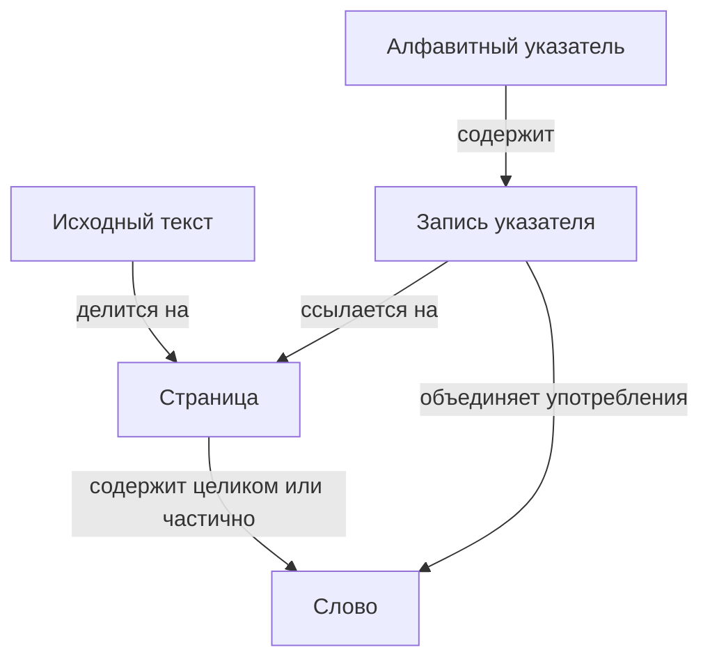
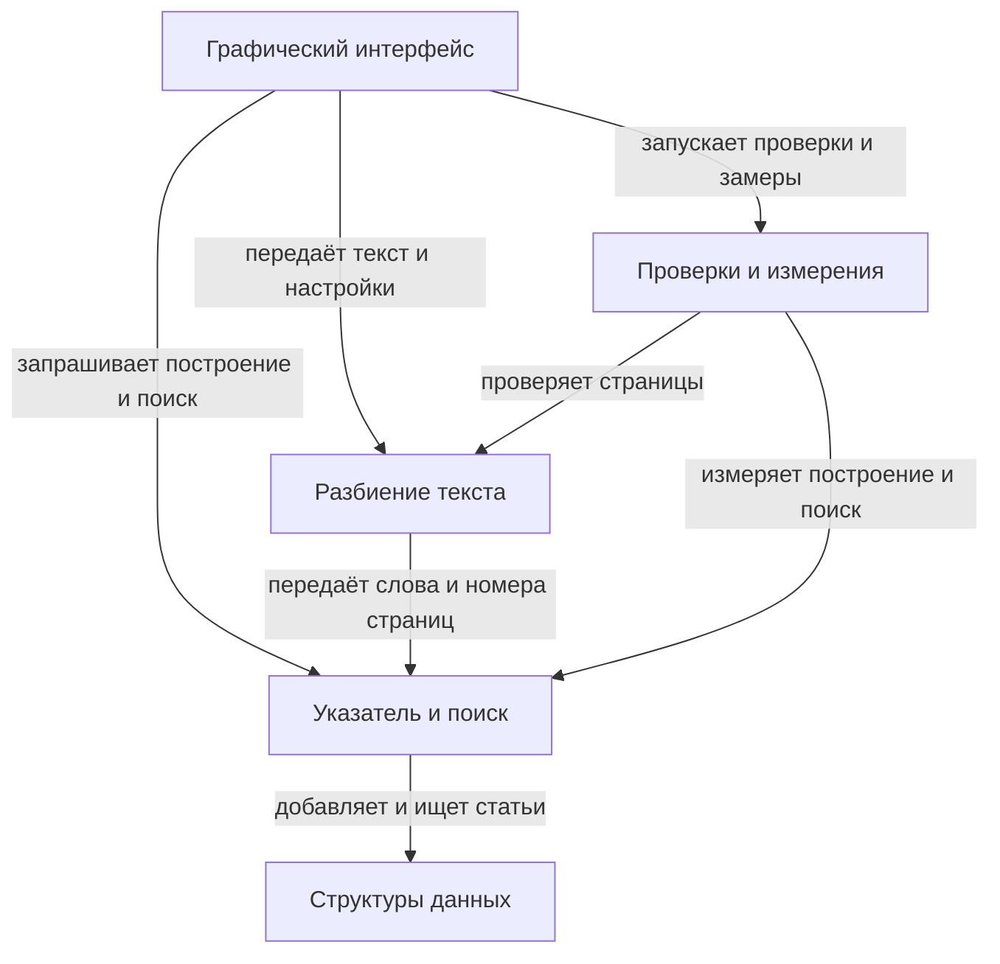

# Дизайн проекта «Алфавитный указатель»

## 1. Постановка задачи

### 1.1. Идея работы

Настольное приложение разбивает введённый текст на пронумерованные страницы и строит алфавитный указатель. Пользователь может просмотреть любую страницу, открыть таблицу указателя или найти страницы с заданным словом. Поиск доступен с учётом регистра и без него. Для построения указателя предусмотрены отсортированный массив и хеш-таблица.

### 1.2. Назначение

Указатель помогает находить места употребления слов в учебных материалах, справочниках и других длинных текстах. Два способа хранения позволяют на одинаковых данных сравнить время построения указателя и поиска по нему.

## 2. Сущности прикладной задачи

### 2.1. Сущности и их назначение

| Сущность             | Описание                                                                                                                |
| -------------------- | ----------------------------------------------------------------------------------------------------------------------- |
| Исходный текст       | Русский, английский или смешанный текст, введённый пользователем вместе с пробелами, переносами строк и пунктуацией.    |
| Страница             | Пронумерованная часть текста с ограниченной вместимостью в словах или символах.                                         |
| Слово                | Фрагмент текста между пробельными разделителями. При разбиении по символам одно слово может занимать несколько страниц. |
| Алфавитный указатель | Перечень статей, по которому можно найти страницы с нужным словом.                                                      |
| Запись указателя     | Слово в форме, принятой для выбранного режима поиска, и список страниц, на которых оно встречается.                     |

### 2.2. Связи между сущностями

## 3. Архитектура

### 3.1. Компоненты системы

| Компонент | Назначение |
| --- | --- |
| Графический интерфейс на Qt Widgets | Принимает исходный текст, настройки и поисковые запросы. Показывает страницы, таблицу указателя, результаты поиска и подсказки. |
| Разбиение текста | Формирует страницы и для каждого употребления целого слова определяет номера его страниц. |
| Построение указателя и поиск | Формирует статьи в двух режимах регистра и ищет слово по запросу пользователя. |
| Структуры данных | Хранят статьи в отсортированном массиве или хеш-таблице и предоставляют операции поиска. |
| Проверки и измерения | Проверяют корректность разбиения и поиска, сравнивают время работы двух структур и сохраняют результаты измерений в CSV. |

### 3.2. Связи между компонентами

### 3.3. Проектные решения и границы проекта

| Решение                         | Принятое правило                                                                                                                                                                                                                                                                                                                                             |
| ------------------------------- | ------------------------------------------------------------------------------------------------------------------------------------------------------------------------------------------------------------------------------------------------------------------------------------------------------------------------------------------------------------ |
| Допустимый размер страницы      | Стандартный размер — целое число от 2 в выбранной единице. Первая страница вмещает половину стандартного размера, каждая десятая — три четверти, остальные — полный размер. Дробная часть отбрасывается. При стандартном размере 2 вместимость первой страницы равна 1. Нумерация начинается с 1. Каждая сформированная страница содержит текст.             |
| Разбиение по словам             | Каждое слово занимает одно место. Если текущая страница заполнена, очередное слово целиком переносится на следующую.                                                                                                                                                                                                                                         |
| Разбиение по символам           | Учитываются целые символы Unicode, включая пунктуацию, и один пробел между соседними словами внутри страницы. При нехватке места начало слова заполняет оставшиеся позиции, а остаток переносится. Это правило действует и для слов, которые целиком уместились бы на пустой странице. Между частями слова сохраняется исходная последовательность символов. |
| Представление исходного текста  | Поле ввода сохраняет исходное написание, пробелы и переносы строк. При просмотре страниц слова показываются в исходном порядке, с исходным регистром и пунктуацией, через один разделяющий пробел.                                                                                                                                                           |
| Граница поиска                  | Один запрос содержит одно слово. Для ключей и запросов одинаково убирается поддерживаемая пунктуация по краям. Цифры и внутренние знаки сохраняются. В список попадают страницы, на которых есть хотя бы часть очищенного слова. Фрагмент, состоящий только из краевой пунктуации, остаётся видимым на странице.                                             |
| Выбор регистра после построения | При построении создаются два указателя выбранной структуры. В одном сохраняется регистр русских и английских букв, во втором они приводятся к нижнему регистру, включая `Ё → ё`. Пользователь может менять режим перед каждым запросом. Оба указателя используют результаты одного разбиения. По умолчанию выбран поиск без учёта регистра.                  |
| Порядок показа                  | Запись обеих структур показываются в алфавитном порядке. Варианты одного слова с разным регистром располагаются рядом и сохраняют своё написание.                                                                                                                                                                                                            |
| Порядок действий в окне         | Команды доступны отдельно. Пользователь может искать сразу после построения, просматривать страницы до или после поиска и переключаться между видами просмотра. При выборе команды приложение проверяет наличие данных, требуемых для неё.                                                                                                                   |

**Пример разбиения.** При стандартном размере 10 и разбиении по символам текст `мир котик дом` даёт страницы `мир к` и `отик дом`. В указателе для `котик` сохраняются номера `[1, 2]`.

**Пример поиска.** Если `Кот` находится на странице 1, а `кот` на странице 2, запрос `Кот` с учётом регистра вернёт `[1]`, а без учёта — `[1, 2]`.

### 3.4. Ключевые алгоритмы и структуры данных

Разбиение последовательно читает слова и запоминает, какие страницы занимает каждое употребление. Построитель обрабатывает целые слова, объединяет употребления с одинаковым ключом и сохраняет номера страниц по возрастанию без повторов. Поиск применяет к запросу правила выбранного указателя и возвращает соответствующий список страниц.

В **отсортированном массиве** статьи размещаются по порядку ключей. Для поиска используются деление интервала пополам или деление по золотому сечению. В **хеш-таблице** ключ определяет корзину. При коллизии ключи проверяются в цепочке этой корзины. Для обеих структур одинаковый текст, запрос и режим регистра дают одинаковые номера страниц.

## 4. Функциональные требования

### 4.1. Действия пользователя и состояние окна

| Команда | Результат и особые сценарии |
| --- | --- |
| Разбить на страницы | Использовать текст, единицу разбиения и стандартный размер. При пустом тексте, в том числе из одних пробельных символов, предложить ввести текст. При размере меньше 2 сообщить о допустимом минимуме. |
| Показать страницы | Дать выбрать номер и показать содержимое страницы. До разбиения вывести «Сначала разбейте текст на страницы». |
| Построить указатели | Взять готовое разбиение и построить оба режима выбранной структуры. Для хеш-таблицы принять положительное число корзин. До разбиения вывести «Сначала разбейте текст на страницы». |
| Показать указатель | Показать слова и номера страниц в выбранном режиме регистра. При отсутствии нужных данных сообщить, требуется ли разбиение или построение. |
| Найти слово | Показать страницы для одного слова в выбранном режиме. Для пустого запроса, в том числе после очистки, или запроса из нескольких слов вывести «Введите одно слово». При отсутствии совпадений вывести «Слово не найдено». Если указатели ещё не готовы, предложить необходимое действие. |
| Изменить исходные данные | При правке текста, единицы разбиения или размера страницы сбросить страницы, указатели и результат поиска. При смене структуры или числа корзин сбросить указатели и результат поиска. При переключении регистра выбрать готовый указатель и сбросить результат предыдущего запроса. |

### 4.2. Проверки и выгрузка результатов

Проверки корректности охватывают минимальный размер, лимиты первой и десятой страниц, перенос слова через несколько страниц, смешанный русский и английский текст, краевую и внутреннюю пунктуацию, оба режима регистра, повтор слова на одной странице и отсутствие совпадения. Отдельно проверяется, что обе структуры дают одинаковый результат.

При сравнении производительности **время построения и время поиска измеряются отдельно**. Обе структуры получают одинаковые результаты разбиения, один и тот же режим регистра и одинаковый набор запросов, включающий существующие и отсутствующие слова. Замер построения начинается с готового разбиения, замер поиска — с готового указателя. Для каждого опыта выполняется несколько повторов и вычисляется медиана.

Команда «Сравнить производительность» запускает измерения и сохраняет результат в отдельный CSV-файл. Одна строка соответствует одной операции для выбранной структуры и набора данных. В ней указаны операция, структура, режим регистра, число слов и уникальных ключей, число корзин для хеш-таблицы, число запросов для поиска, число повторов и медианное время в миллисекундах.
